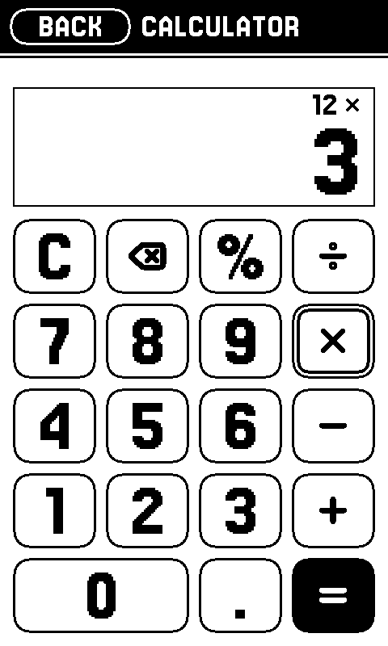

# Calculator

A pocket calculator for quick sums.

## Screenshot

Drawn on a PC by `tools/preview/screenshots.sh`, with the same pixels the panel shows.

## How it works

It works like a desk calculator. Each operator works out the sum so far straight away, so 2 + 3 × 4 gives 20, not 14.

- **Numbers:** up to 12 digits, with one point. A point typed first gets a 0 before it.
- **+ − × ÷:** while a sum is waiting, the display shows its first number and the operator, such as `15 ×`, and that operator's key is framed. Tap a different operator to change your mind.
- **=:** works out the sum. Tap it again to repeat the last step: 2 + 3 = = gives 8. With no second number typed, it uses the one shown, so 5 + = gives 10.
- **%:** after + or −, it turns the number into a percent of the first number, so 200 + 10 % shows 20, and = then gives 220. After × or ÷, or on its own, it divides the number by 100: 200 × 10 % = gives 20.
- **Backspace:** removes the last digit typed. It doesn't change a result.
- **C:** clears everything.

Dividing by zero, or a result with more than 12 digits, shows `ERROR`. Tap C, or start typing a new number.

## Getting around

Tap BACK to return to the apps page.

## Saves

The number on screen and any waiting sum are saved with every key, so they're still there after the device sleeps.

## Credits

The icons are drawn from [Lucide](https://lucide.dev) (ISC licence): calculator, plus, minus, x, divide, delete and equal.
