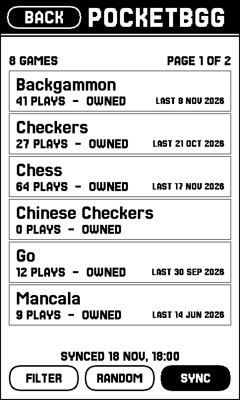

# PocketBGG

Your BoardGameGeek collection, to browse on the device, with each game's cover, plays and the date you last played it. It's kept on the SD card, so it works without Wi-Fi once synced.

## Screenshot



Drawn on a PC by `tools/preview/screenshots.sh`, with the same pixels the panel shows, from a made-up collection.

## Setting up

PocketBGG needs your BGG username and an API token, which BGG gives to each person who registers to use its data.

1. On [boardgamegeek.com/applications](https://boardgamegeek.com/applications), register a non-commercial application if you haven't already. BGG has to approve it, which can take a few days.
2. Open the approved application and use **Create token**. Use the API token, not the MCP one.
3. Open PocketBGG once, so it makes the folder `/pocketbgg` on the SD card.
4. Put the card in a computer, and in that folder make a text file named `config.txt`, with Notepad for example:
   ```
   username=your_bgg_username
   token=your-token
   ```
5. Put the card back and tap `SYNC`.

The token is read from the card each time you sync, so a corrected file counts straight away. It's never shown, logged or saved anywhere else, and it's sent only to boardgamegeek.com, after the device has checked BGG's certificate. Anyone holding your card can read the file, though, so if you lose the card, delete the token on BGG's applications page and make a new one.

If `SYNC` doesn't get as far as Wi-Fi, the line above it says what's wrong with `config.txt`, such as `CONFIG.TXT HAS NO TOKEN=`.

## Getting around

- The list shows each game's name, with how many times it's been played and its status under it, such as `33 PLAYS - OWNED`, and at the right of that line, smaller, when it was last played: `LAST 17 NOV 2026`. The year is on the game's details. Long names wrap onto a second line rather than being cut short.
- The Up and Down buttons turn the pages, and wrap around: Down on the last page goes back to page 1, and Up on page 1 to the last. `PAGE 1 OF 25` at the top says where you are, and the count on the left how many games there are.
- The list is kept on the card, so it's there without Wi-Fi, after sleep and after a restart. The line above `SYNC` says when it was last synced, in the time zone chosen in Settings.
- `SYNC` downloads your whole collection from BGG: every game with any status (owned, wishlist, previously owned and the rest), expansions included. It joins Wi-Fi, opening the Wi-Fi screen if it isn't already connected, and turns the radio off again when it's done. BGG often answers "preparing it" first, so it waits 5 seconds and asks again, up to 6 times. After the collection it reads every play you've logged, 100 a page with a 5 second pause between pages as BGG asks, for each game's last-played date: about 4 minutes for 3,400 plays. The list can be browsed meanwhile, and the line above `SYNC` says how far it's got, such as `READING PLAYS, PAGE 12 OF 34`. `BACK` stops it, and the dates read so far are kept. `BACK` while it's downloading stops it first.
- `FILTER` chooses which games the list shows, and starts at owned games only. Tap a row to switch it:
  - a status (owned, preordered, for trade, wishlist, want to buy, want to play, want, previously owned), with how many of your games have it. A game shows if it has any status that's on, and at least one always stays on.
  - `PLAYED AT LEAST ONCE`, to hide games you haven't played.
  - `PLAYERS`, which steps through any, 1 to 7, and 8 or more, to show games that play with that many. A game BGG gives no player count for still shows.
  - `ORDER`, A-Z or last played: the most recently played first, and games never played last.

  `SHOWING 99 OF 203` at the top says what the choices leave, and `BACK` returns to the list. The list's count then reads `99 OF 203 GAMES`. A sync keeps the filter.
- Last, a sync fetches each game's cover from BGG's image server and keeps it on the card, dithered to black and white: under a second a cover, so about 2.5 minutes for 200 games the first time, and a first sync about 7 minutes in all. After that only new games' covers, and covers changed on BGG, are fetched, so a sync is about 4 minutes, nearly all of it the plays. The line above `SYNC` says `FETCHING COVERS, 12 OF 41`. `BACK` stops it, the covers fetched so far are kept, and the next sync carries on with the rest. Covers of games that have left your collection are deleted.
- Tap a game to see its details: its cover, year, plays and status, player count, play time and the date it was last played. `NO COVER YET` means it hasn't been fetched, and `NO COVER ON BGG` that BGG has no picture of it.
- `RANDOM` opens the details of one of the games the list shows, picked at random, so set `FILTER` first to choose among owned games for 4 players, say. `BACK` and `RANDOM` again for another: it never picks the same game twice in a row.
- On a game's details, Down shows the next game and Up the one before, in the list's order and through its filter, wrapping from the last game to the first and back: `GAME 12 OF 99` at the top says where you are. `BACK` returns to the list, on the page holding the game you ended on.
- `BACK` on the list returns to the APPS page.

## Saves

All in `/.pocketplay/`:

| Name | Holds |
|---|---|
| `pocketbgg-list` | The collection as it was last synced, and when, with each game's last-played date. It's replaced only once a new sync has fully arrived and been read, so a failed sync keeps the old list. About 200 bytes a game. |
| `pocketbgg-filter` | The filter's choices and the order, saved on every change. |
| `pocketbgg-t<game>-<picture>` | One game's cover, 1 bit a pixel, up to 200 by 200: about 4 KB, so under 1 MB for 200 games. The second number is BGG's picture id, so a changed cover is fetched again. |

Your username and token stay in `/pocketbgg/config.txt`, which PocketBGG only ever reads.

## Credits

- The collection, plays and covers come from [BoardGameGeek](https://boardgamegeek.com) through its XML API, under BGG's terms for it, and each game's details say `POWERED BY BGG`.
- Covers are decoded with [stb_image](https://github.com/nothings/stb) by Sean Barrett (public domain or MIT, in `third_party/LICENSE-stb.txt`), and dithered with the FreeInk SDK's image tone mapper.
- The icon is "dices" from [Lucide](https://lucide.dev) (ISC).
