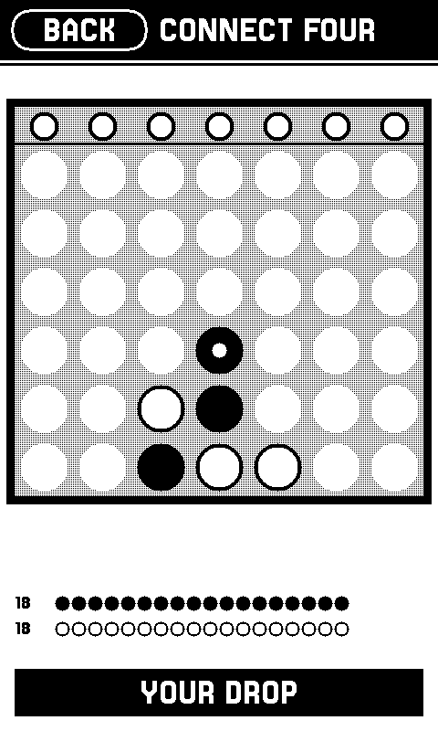

# Connect Four

Drop discs into a seven-column, six-row frame against the computer, and be the first to line up four.

## Screenshot

Drawn on a PC by `tools/preview/screenshots.sh`, with the same pixels the panel shows.

## Rules

- You play the outlined discs and always go first. The computer plays the solid ones.
- Tap a column and your disc falls to the lowest free place in it. The computer drops its disc straight after yours.
- Four of your discs in a line, across, up or on either diagonal, wins.
- If the board fills with no line of four, the game is a draw.

## Getting around

- **Menu:** games played and won, the last game's final board with its winning four marked, and `PLAY`. While a game is unfinished, it shows `RESUME` and `NEW GAME` instead.
- **Board:** the slots across the top show where your disc will drop. They go grey on the computer's turn and over a full column. The last disc played has a dot on it, and under the board are the discs each side has left.
- **Result:** the final board with the winning four struck through, then `PLAY AGAIN` or `DONE`.
- **How to play:** three pages. `NEXT` turns them and `GOT IT` returns to the menu. The Down button also steps forward and Up steps back.
- `BACK` in the header goes from the board, result or how to play to the menu, and from the menu to the home page.

## Saves

All in `/.pocketplay/`:

| Name | Holds |
|---|---|
| `connectfour` | The game in play. Written after every disc, so sleep or a flat battery brings you back to it, and erased when the game ends. |
| `connectfour-record` | Wins, losses and draws, and the last game's final board. |

## Credits

Copied from CrossPlay and modified for PocketPlay, under the MIT licence (`LICENSE-CrossPlay.txt`).
