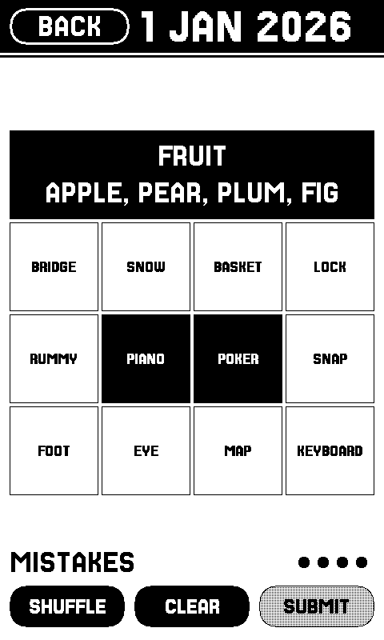

# Connections

Sixteen words hide four groups of four. Find all four groups before you make four mistakes. It's the New York Times' daily puzzle, and every past one can be played too.

## Screenshot

Drawn on a PC by `tools/preview/screenshots.sh`, with the same pixels the panel shows.

## Rules

- Each group shares something: a category, a hidden word, a phrase they complete, and so on. Some words seem to fit more than one group, but each word belongs to exactly one.
- Pick four words you think belong together and tap `SUBMIT`.
- A right guess turns the four into a solved row with the group's name on it.
- A wrong guess costs one of your four mistakes. `ONE AWAY` means three of the four were right.
- Guessing the same four twice doesn't cost a second mistake; you'll see `ALREADY GUESSED`.
- Find all four groups to win. After the fourth mistake the game is lost, and every group is shown.

## Getting started

The device has no puzzles until you fetch them. On the menu, tap `GET PUZZLES`. It joins Wi-Fi if needed, downloads every published puzzle in one go, and turns the radio off again. `BACK` stops a download. After that, playing never uses the network. It reads `ALL CAUGHT UP` when today's puzzle is already on the card.

## Getting around

- **Menu:** tap the newest puzzle's date to play it. It says whether it's not started, in progress or solved, and an unfinished puzzle carries on where you left it. Below are your record, the last sixteen days as a small board (solid for a clean solve, grey for a solve with mistakes, a cross for a loss), and `HOW TO PLAY`, `ARCHIVE` and `GET PUZZLES`. Tapping the sixteen days also opens the archive.
- **Board:** tap a word to select it (it turns solid black), and tap it again to unselect it. `SHUFFLE` moves the words around without changing the answer, `CLEAR` unselects everything, and `SUBMIT` works once four are picked. The four dots are the mistakes you have left.
- **Archive:** a calendar, one month at a time. Use the `YEAR` and `MONTH` steppers to move, and `TODAY` to jump back to the newest month. Tap a day to play it. A clean solve has a sparkle, a solve with mistakes has one dot per mistake, and a loss has a cross.
- **How to play:** a short reminder of the rules, with an example.
- `BACK` in the header goes from the board, archive or how to play to the menu, and from the menu to the home page.

## Your record

- The streak counts back from the newest puzzle on the card, and skips that day while it's unplayed.
- The first time you finish a day is the result that's kept. Playing it again doesn't change it.

## Saves

All in `/.pocketplay/`:

| Name | Holds |
|---|---|
| `connections` | The puzzle being played: its order, the groups found, mistakes, guesses tried and the words selected. Written on every change and erased when the game ends. |
| `connections-pack` | Every downloaded puzzle. |
| `connections-results` | How each day went. |

## Credits

Copied from CrossPlay and modified for PocketPlay, under the MIT licence (`LICENSE-CrossPlay.txt`). The icon is from Lucide (ISC licence). The puzzles are the New York Times', fetched from Eyefyre/NYT-Connections-Answers.
