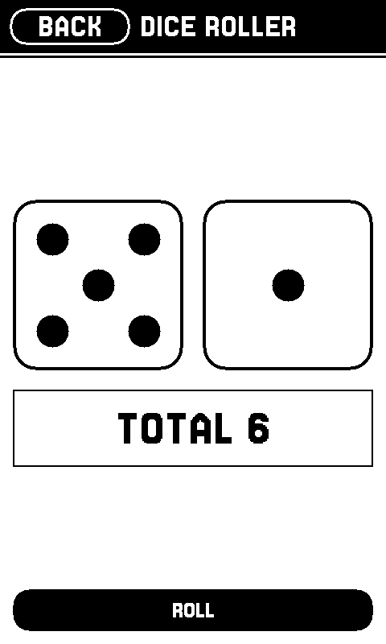

# Dice Roller

Two six-sided dice and their total, for any board game that needs them.

## Screenshot

Drawn on a PC by `tools/preview/screenshots.sh`, with the same pixels the panel shows.

## Getting around

- `ROLL`, or the Down button, rolls both dice together. The pips show each die, and the capsule under them shows the total.
- There's nothing else to track: roll as often as you like.
- `BACK` in the header returns to the home page.

## How the dice stay fair

The chip's random numbers are only guaranteed to be truly random while the radio is on, and PocketPlay keeps it off. So every roll also mixes in the exact microsecond of your tap, which no one can repeat, then picks each face by rejection sampling: random values that would favour some faces are thrown back, so all six are exactly equally likely. The PC tests roll 600,000 times and check the faces, all 36 pairs, the totals and back-to-back rolls for fairness.

## Saves

All in `/.pocketplay/`:

| Name | Holds |
|---|---|
| `diceroller` | The last roll, so sleep or a flat battery brings back the same dice. |
