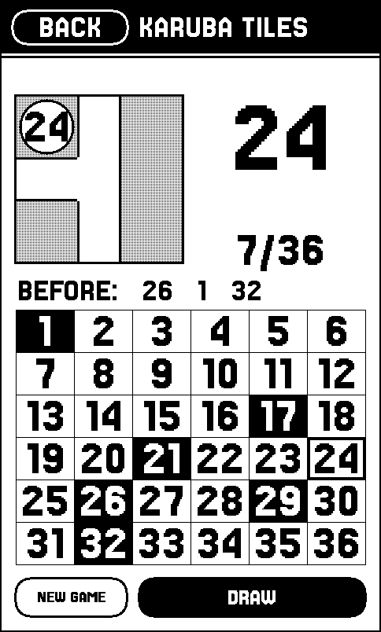

# Karuba Tiles

Draws the jungle tiles for a game of Karuba. In each round the leading player draws one of the 36 tiles at random, every player takes the tile with the same number from their own set, and places it. Karuba Tiles does the drawing, with no repeats, and keeps a board of every tile that's out.

## Screenshot

Drawn on a PC by `tools/preview/screenshots.sh`, with the same pixels the panel shows.

## Getting around

- **Drawing:** `DRAW`, or the Down button, draws the next tile. It's drawn at the top left with its number in the corner, its paths in white through the grey jungle, and its treasure in the bottom-right corner: an outlined diamond for a crystal, a solid one for gold. Beside it are its number in large type, `CRYSTAL` or `GOLD` if it has one, and how many tiles are out, such as `7/36`. The three tiles drawn before it are listed under it, newest first.
- **The board:** drawn tiles turn black. The latest is the white one with the thick frame.
- **The end:** once all 36 are out, `DRAW` greys to `ALL DRAWN`.
- **Starting over:** `NEW GAME` clears the draws. It asks first by changing to `SURE?`, and a tap anywhere else takes that back.
- **Leaving:** `BACK` returns to the home page. The draws are kept, so the game opens where it was.

The tile is drawn as printed, with its number upright. You can still turn it any way you like on the table.

## How the draws stay fair

Every draw mixes the chip's random number with the exact microsecond of your tap, then picks from the tiles left by rejection sampling, so every tile left is exactly equally likely. The PC tests make 360,000 first draws and play 72,000 whole games to check that no tile and no position is favoured.

## Saves

All in `/.pocketplay/`:

| Name | Holds |
|---|---|
| `karubatiles` | Every draw in order, saved on each draw, so sleep or a flat battery carries on where it was. Erased by `NEW GAME`. |

## Credits

Karuba is a game by Rüdiger Dorn, published by HABA. This is an unofficial companion, not affiliated with either. The tile drawings are PocketPlay's own: only each tile's paths and treasure are taken from the printed set. The icon is Lucide's tree-palm (ISC licence).
