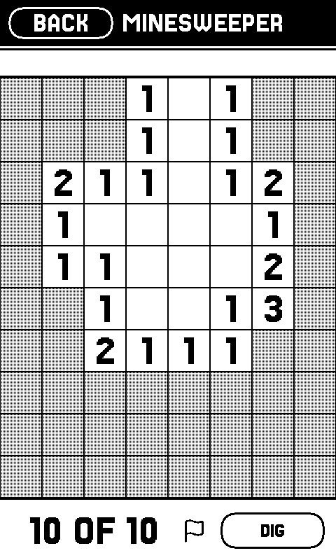

# Minesweeper

An eight by ten board with ten mines hidden in it. Open every safe square without hitting a mine.

## Screenshot

Drawn on a PC by `tools/preview/screenshots.sh`, with the same pixels the panel shows.

## Rules

- Tap a square to dig it. If it's a mine, you lose.
- A safe square shows how many of its eight neighbours are mines. A square with no neighbouring mines opens all its neighbours for you, so a whole area can open at once.
- Plant a flag on a square you're sure is a mine, so you don't dig it by accident.
- Your first dig is always safe, and always opens an area: the mines are laid after it, away from it and its neighbours.
- **Chording:** tap a number that already has that many flags around it, and all its other neighbours open at once. If one of those flags was wrong, you dig a mine and lose.
- Dig every safe square to win.

## Getting around

- **Menu:** your record (played, cleared), the last finished board, and `PLAY` and `HOW TO PLAY`. With a board in play, `PLAY` reads `RESUME`, and `NEW GAME` sits under it.
- **Board:**
  - Tap to dig. Hold a square for under half a second (400 ms) to plant or lift a flag. The square gets a heavy border while the hold builds.
  - The `DIG` / `FLAG` button under the board switches what a tap does. A hold flags either way.
  - The count shows how many mines are left unflagged.
  - When the game ends, the mines are shown, with `CLEARED` or `BOOM` under the board. Tap it to see the result.
- **Result:** squares opened and mines flagged, then `PLAY AGAIN` or `DONE`.
- **How to play:** five lessons, each with a small example board.
- `BACK` in the header goes from how to play, the board or the result to the menu, and from the menu to the home page.

## Saves

Both in `/.pocketplay/`:

| Name | Holds |
|---|---|
| `minesweeper` | The board in play, and whether a tap digs or flags. Written on every change and erased when the game ends. |
| `minesweeper-history` | Wins, losses and the last finished board, for the menu. |

## Credits

Copied from CrossPlay and modified for PocketPlay, under the MIT licence (`LICENSE-CrossPlay.txt`). The icon is from Lucide (ISC licence).
