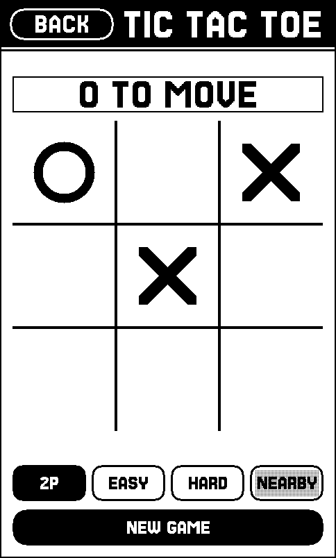

# Tic Tac Toe

Two players share one device and take turns on a 3x3 grid, or one plays the computer.

## Screenshot

Drawn on a PC by `tools/preview/screenshots.sh`, with the same pixels the panel shows.

## Rules

- X always moves first, then the players take turns.
- Tap an empty square to put your mark there.
- The first player to get three marks in a row (across, down or diagonally) wins.
- If all nine squares fill up and nobody has three in a row, the game is a draw.

## Playing the computer

The buttons under the grid choose who you play: `2P` for two players on one device, or `EASY` or `HARD` against the computer. The one being played is filled.

- `EASY` takes a win when it sees one, but only blocks yours half the time. It can be beaten.
- `HARD` looks through every move to the end of the game, so it never loses. A draw is the best you can do.

You and the computer take turns to go first: you're X in your first game, and the computer is X in the next. The line above the grid says which mark is yours (`YOUR MOVE (X)`).

`NEARBY`, greyed for now, is for two devices.

## Getting around

- The line above the grid says whose turn it is (`X TO MOVE`, or `YOUR MOVE (X)` against the computer), or how the game ended (`X WINS`, `O WINS`, `YOU WIN`, `COMPUTER WINS`, `A DRAW`).
- A mode button starts a new game with those players, and `NEW GAME` starts one with the same players.
- If you've already made a move, they ask first: the line says `END THIS GAME?`, and `NEW GAME` starts the new one while `KEEP PLAYING`, or a tap anywhere else, goes back to the game.
- `BACK` in the header returns to the home page. The game is kept, so you can finish it later.

## Saves

`tictactoe` holds the board, whose turn it is, and against the computer its level and mark. It's written after every move, so sleep or a flat battery brings you back to the same board, and it's erased when the game ends or you tap `NEW GAME`.

## Credits

Copied from CrossPlay and modified for PocketPlay, under the MIT licence (`LICENSE-CrossPlay.txt`). The icon is from Lucide (ISC licence).
