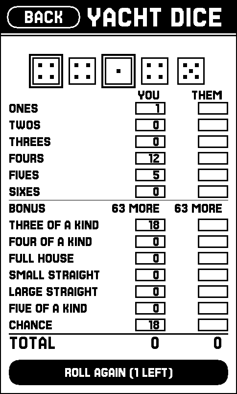

# Yacht Dice

Five dice, three rolls a turn and a scorecard of thirteen boxes, against the computer. Fill every box, and the higher total wins.

## Screenshot

Drawn on a PC by `tools/preview/screenshots.sh`, with the same pixels the panel shows.

## Rules

- On your turn, roll all five dice. Tap the dice you want to keep, and roll the rest again, up to three rolls in all.
- Then put the dice in one free box on your card. Every box is used exactly once, and a box you can't make scores 0.
- The top half scores the dice showing that face, so three 4s in Fours are 12. Sixty-three or more there earns 35 more.
- The bottom half: three or four of a kind score all five dice; a full house 25; a small straight (four in a row) 30; a large straight (five in a row) 40; five of a kind 50; and chance all five dice, whatever they are.
- A second five of a kind scores 100 more if the first scored 50. It must then go in the matching top box if that's free; if not, in any bottom box, where full house and the straights score in full; and only if those are all used, in a top box for 0.
- Each player has thirteen turns. The game ends when both cards are full.

## Getting around

- **Menu:** games played and won, your personal best, and the dice of your last five of a kind with how many you've rolled. `PLAY` starts a game. While a game is unfinished, it shows `RESUME` and `NEW GAME` instead.
- **Card:** the dice across the top, then your column and the computer's. Each of your free boxes shows what it would score with the dice now, so the choice is there to read. A held die has a frame around it; tap it again to let it go. The button under the card reads `ROLL`, then `ROLL AGAIN (2 LEFT)`, then `TAKE A BOX`. The bonus line counts down to 63, then shows `+35`, or `GONE` once it can't be reached. The computer plays its turn straight after yours, a roll at a time.
- **Result:** who won and the totals, and the boxes where the game was won or lost. Then `PLAY AGAIN` or `DONE`.
- **How to play:** four pages. `NEXT`, or the Up and Down buttons, turns them.
- `BACK` in the header goes from the card, result or how to play to the menu, and from the menu to the home page.

## Saves

All in `/.pocketplay/`:

| Name | Holds |
|---|---|
| `yachtdice` | The game in play. Written after every roll, hold and box, so sleep or a flat battery brings you back to it, and erased when the game ends. |
| `yachtdice-record` | Games played and won, your best total, and your five of a kinds. |

## Credits

Ported from CrossPlay's Yahtzee and modified for PocketPlay, under the MIT licence (`LICENSE-CrossPlay.txt`). The icon is drawn from Lucide's `clipboard-list` (ISC licence).
